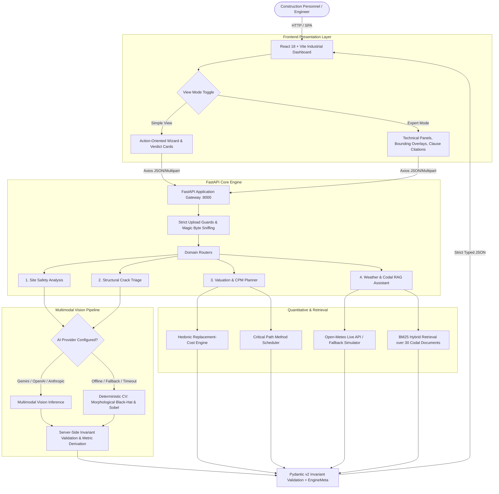

# 🏗️ Construction Intelligence System Platform

[](https://www.python.org/)
[](https://fastapi.tiangolo.com/)
[](https://react.dev/)
[](https://vitejs.dev/)
[](https://tailwindcss.com/)
[](https://www.docker.com/)
[](https://docs.pydantic.dev/)
[](LICENSE)

> **An industrial-grade, multimodal decision-support console for construction and civil engineering professionals.**
> Fuses **computer vision analysis** (site safety & PPE detection, structural crack triage), **quantitative financial & schedule modelling** (hedonic valuation, CPM scheduling), and **retrieval-augmented engineering knowledge** (IS, ACI, OSHA, NBC, and RERA codal provisions) behind a unified, strictly-typed API and a responsive industrial UI.

---

## 📑 Table of Contents

- [System Architecture](#-system-architecture)
- [Key Features & Modules](#-key-features--modules)
- [Dual-View Information Architecture](#-dual-view-information-architecture)
- [Core Architectural Invariants](#-core-architectural-invariants)
- [Quick Start](#-quick-start)
  - [Prerequisites](#prerequisites)
  - [Option A: Docker (Single-Origin Production)](#option-a-docker-single-origin-production)
  - [Option B: Local Development](#option-b-local-development)
- [Configuration & Environment Variables](#-configuration--environment-variables)
- [API Contract & Endpoints](#-api-contract--endpoints)
- [Project Directory Structure](#-project-directory-structure)
- [Testing & Quality Assurance](#-testing--quality-assurance)
- [Engineering Design Decisions](#-engineering-design-decisions)
- [Regulatory & Codal Alignment](#-regulatory--codal-alignment)
- [Limitations & Operational Scope](#-limitations--operational-scope)
- [License](#-license)

---

## 🏛 System Architecture

The platform is designed with a **fault-tolerant, layered architecture** where all AI perception feeds strictly through deterministic mathematical verification. Every module runs out-of-the-box with **zero external API keys** via calibrated offline heuristics, with optional plug-and-play multimodal LLM backends (Gemini, OpenAI, Anthropic).



---

## 🚀 Key Features & Modules

### 1. Site Safety Monitoring (`POST /api/analysis/safety`)
- **Worker & PPE Detection**: Automatic assessment of safety helmets (IS 2925), hi-vis vests, eye protection, and safety harnesses.
- **Hazard Localization**: Severity-ranked hazard detection with normalized bounding boxes mapped onto the site canvas.
- **Stop-Work Recommendations**: Automatic triggering of stop-work safety flags when critical fall risks, edge hazards, or severe compliance deficits are detected.
- **Fail-Safe Fallback**: Works offline using pixel luminance, clutter density, worker color clustering, and skin-to-vest ratios.

### 2. Crack Detection & Structural Analysis (`POST /api/analysis/crack`)
- **Morphological Black-Hat Transformation**: Isolates narrow, dark linear surface fissures from ambient concrete surface texture.
- **Codal Width Banding**: Classifies crack severity according to **ACI 224R-01** and **IS 456:2000** criteria.
- **Spread vs. Coherence Diagnostics**: Separates isolated structural cracks from distributed aggregate crazing and map cracking.
- **Remediation Method Statements**: Generates technical repair pathways (epoxy injection, polyurethane grouting, CFRP composite jacketing) aligned with **EN 1504** and **ACI 503R**.

### 3. Valuation & CPM Project Planning
- **Hedonic Cost Valuation (`POST /api/valuation`)**: Deterministic replacement-cost algorithm calculating base city rates adjusted for age depreciation, structural framing, floor elevation, parking, and amenity deltas.
- **CPM Schedule Generator (`POST /api/plan`)**: Quantity-driven project milestone scheduler pacing substructure, superstructure, MEP, and architectural finishes with calendar-aware contingency modeling.

### 4. Weather-Aware Site Advisory & Codal RAG Assistant
- **Live Concrete Pour Advisory (`GET /api/weather/advisory`)**: Evaluates real-time weather data against IS 456 and ACI 305R/306R rules (ambient placement limits, rain wash-out risk, high-wind crane stand-downs, and wet-bulb globe temperature heat stress).
- **Standards RAG Engine (`POST /api/assistant/chat`)**: Curated search across 30 regulatory documents (IS 456, ACI 224/305/306/503/440, OSHA 1926, NBC 2016, and RERA provisions). Strict metadata gating rejects off-topic queries with an honest *no-match* instead of generating hallucinations.

---

## 🔄 Dual-View Information Architecture

Construction platforms serve both project executives and on-site field engineers. Rather than compromising technical accuracy, this platform provides **two tailored views over the exact same backend contract**, toggled seamlessly with persistent state:

| Feature / Dimension | 👷 Simple View (Site Owner / Contractor) | 📐 Expert Mode (Structural Engineer / Safety Officer) |
|---|---|---|
| **Primary Goal** | Instant situational verdict & clear action items | Technical parameters, raw metrics, and standard clauses |
| **Safety Analysis** | "Safe to work" green/amber/red status + 3 action steps | Normalized bounding box canvas, compliance bars, hazard logs |
| **Crack Inspection** | Plain-English summary + triage checklist | Width estimation (mm), orientation angle, ACI 224 band, method statements |
| **Valuation / Plan** | Final estimated cost + handover milestone target | Itemized driver breakdowns, CPM Gantt timelines, resource distributions |
| **Weather Advisory** | "Good day to pour concrete" verdict banner | Wind speeds, WBGT index, workability matrices, 7-day outlook |
| **Codal Assistant** | Natural conversational answers with jargon simplification | Exact clause citations, BM25 retrieval scores, document chunk references |

---

## 🛡️ Core Architectural Invariants

| Invariant | Implementation Mechanism | Engineering Guarantee |
|---|---|---|
| **Never Dead-End** | Deterministic fallback pipeline for all AI tasks | The platform is 100% functional with zero API keys. Vision defaults to computer vision algorithms; Assistant defaults to BM25 retrieval. |
| **Honest Attribution** | `EngineMeta` attached to every response payload | Every output explicitly states whether it was generated by an LLM or offline heuristics, including model name, confidence score, and latency. |
| **Zero Contract Drift** | Pydantic v2 schemas configured with `extra="forbid"` | All request and response structures are validated against strict contracts; unverified fields are rejected at the gateway. |
| **Server-Side Truth** | Arithmetic and invariants are re-derived on the server | The LLM is never permitted to calculate sums or project dates. Critical hazards automatically escalate overall risk server-side. |
| **Grounded Retrieval** | Dual BM25 + Curated Metadata gating | Out-of-domain technical questions yield an explicit refusal rather than plausible-sounding codal hallucinations. |

---

## ⚡ Quick Start

### Prerequisites
- [Git](https://git-scm.com/)
- [Docker](https://www.docker.com/) & Docker Compose (for containerized deployment), **OR**
- [Python 3.12+](https://www.python.org/) and [Node.js 20+](https://nodejs.org/) (for local development)

### Clone the Repository

```bash
git clone https://github.com/AnkitGit-prog/construction-intelligence-system-platfprm.git
cd construction-intelligence-system-platfprm
```

---

### Option A: Docker (Single-Origin Production)

The multi-stage `Dockerfile` builds the Vite SPA and packages it directly with the FastAPI backend into a single lightweight, non-root production container.

```bash
# 1. Build and run with Docker Compose
docker compose up --build
```

Access the application:
- **Interactive Web Console**: [http://localhost:8000](http://localhost:8000)
- **Interactive OpenAPI Documentation**: [http://localhost:8000/docs](http://localhost:8000/docs)
- **System Health & Engine Capabilities**: [http://localhost:8000/health](http://localhost:8000/health)

---

### Option B: Local Development

Run the frontend and backend in separate terminals:

#### Terminal 1 — Backend (FastAPI)
```bash
cd backend
python -m venv .venv

# On Linux/macOS:
source .venv/bin/activate
# On Windows (PowerShell):
.venv\Scripts\Activate.ps1

pip install -r requirements-dev.txt
cp .env.example .env

# Run development server
uvicorn main:app --reload --port 8000
```

#### Terminal 2 — Frontend (React + Vite)
```bash
cd frontend
npm install
npm run dev
```

The frontend development server runs at [http://localhost:5173](http://localhost:5173) and automatically proxies `/api` calls to `:8000`.

---

## ⚙️ Configuration & Environment Variables

The application runs seamlessly with default configurations and no `.env` file required. To configure multimodal LLMs or customize operational limits, copy `backend/.env.example` to `backend/.env`:

| Environment Variable | Default Value | Description |
|---|---|---|
| `AI_PROVIDER` | `auto` | Engine selection: `auto` (picks first available key), `gemini`, `openai`, `anthropic`, or `heuristic` |
| `GEMINI_API_KEY` | *(empty)* | Google Gemini API key (recommended: `gemini-1.5-flash` or newer) |
| `OPENAI_API_KEY` | *(empty)* | OpenAI API key for GPT-4o vision / analysis |
| `ANTHROPIC_API_KEY` | *(empty)* | Anthropic API key for Claude 3.5 Sonnet |
| `MAX_UPLOAD_MB` | `12` | Maximum allowable image file upload size in megabytes |
| `WEATHER_PROVIDER` | `open-meteo` | Weather backend: `open-meteo` (live, no key required) or `simulated` |
| `CORS_ORIGINS` | `http://localhost:5173,http://localhost:4173` | Allowed CORS origins for external client calls |
| `SERVE_FRONTEND` | `true` | Automatically serves built SPA files from FastAPI in production |

---

## 🔌 API Contract & Endpoints

| HTTP Method | Endpoint | Description | Key Request Parameters |
|---|---|---|---|
| `POST` | `/api/analysis/safety` | Inspect site photograph for PPE and safety hazards | `image` (Multipart), `site_context`, `strictness` |
| `POST` | `/api/analysis/crack` | Structural crack detection & severity grading | `image` (Multipart), `surface_type`, `estimated_width_mm` |
| `POST` | `/api/valuation` | Hedonic property replacement-cost valuation | `city`, `super_built_up_area_sqft`, `asset_class`, `age_years` |
| `POST` | `/api/plan` | Quantity-driven CPM milestone schedule generation | `built_up_area_sqft`, `floors`, `structure_type`, `target_months` |
| `GET` | `/api/weather/advisory` | Real-time weather and pour advisories | `latitude`, `longitude`, `city` |
| `POST` | `/api/assistant/chat` | Codal RAG query answering | `query`, `conversation_history` |
| `GET` | `/health` | Service liveness probe & active engine capabilities | *None* |
| `GET` | `/api/contracts` | Complete JSON schema definitions for all models | *None* |

### Uniform Error Response Envelope
Every failure (validation, oversized upload, unsupported MIME type, or provider error) produces a consistent, predictable structure:
```json
{
  "error": {
    "code": "file_too_large",
    "message": "Image size exceeds limit of 12 MB.",
    "field": "image",
    "request_id": "req-9c8a1e2f"
  },
  "status": 413
}
```

---

## 📁 Project Directory Structure

```
construction-intelligence-system-platfprm/
├── backend/
│   ├── main.py                  # FastAPI application entrypoint, CORS & error handlers
│   ├── config.py                # Pydantic-settings environment schema
│   ├── models/
│   │   └── schemas.py           # Strictly-typed Pydantic request/response contracts
│   ├── routers/
│   │   ├── _common.py           # Request ID tracking & upload validation guards
│   │   ├── analysis.py          # Vision endpoints (/safety, /crack)
│   │   ├── valuation.py         # Quantitative endpoints (/valuation, /plan)
│   │   └── advisory.py          # Advisory endpoints (/weather, /assistant)
│   ├── services/
│   │   ├── llm.py               # Multimodal LLM adapters (Gemini, OpenAI, Anthropic)
│   │   ├── image_ops.py         # Pillow/NumPy computer vision & morphology algorithms
│   │   ├── safety.py            # Safety hazard detection & invariant derivation
│   │   ├── crack.py             # Crack width estimation & EN 1504 remediation planning
│   │   ├── valuation.py         # Hedonic replacement-cost calculation engine
│   │   ├── planner.py           # Critical path method (CPM) timeline generator
│   │   ├── weather.py           # Open-Meteo live advisory & pour restrictions
│   │   ├── knowledge.py         # Hybrid BM25 codal knowledge retrieval
│   │   └── common.py            # Severity calculation utilities & EngineMeta factory
│   ├── data/
│   │   └── knowledge_base.json  # 30-document indexed codal knowledge corpus
│   ├── static/samples/          # High-resolution benchmark sample images
│   ├── tests/
│   │   └── test_api.py          # 84 test cases covering contracts, invariants & RAG
│   ├── requirements.txt         # Production Python dependencies
│   ├── requirements-dev.txt     # Test & linting dependencies
│   └── .env.example             # Configuration reference
├── frontend/
│   ├── src/
│   │   ├── components/
│   │   │   ├── Navbar.jsx       # Header with real-time health indicator & mode toggle
│   │   │   ├── Sidebar.jsx      # Navigation drawer for modules
│   │   │   ├── Overview.jsx     # High-level system dashboard
│   │   │   ├── SafetyMonitor.jsx# Site safety upload & bounding box viewer
│   │   │   ├── CrackAnalyzer.jsx# Crack detection overlay & structural method statements
│   │   │   ├── ValuationPlanner.jsx # Cost calculation & CPM Gantt breakdown
│   │   │   ├── WeatherAdvisory.jsx  # Weather workability & pour permits
│   │   │   ├── AssistantChat.jsx    # Codal search assistant
│   │   │   └── ui/              # Modular UI components (StatusCard, Wizard, Primtives)
│   │   ├── lib/
│   │   │   ├── api.js           # Central Axios HTTP client with error interceptors
│   │   │   ├── format.js        # Currency, date, and risk formatting helpers
│   │   │   ├── plainEnglish.js  # Jargon translation layer for Simple View
│   │   │   └── viewMode.jsx     # ViewModeContext provider and storage
│   │   ├── App.jsx              # Main dashboard composition
│   │   ├── index.css            # Tailwind styles & theme variables
│   │   └── main.jsx             # React DOM root
│   ├── package.json             # Frontend dependencies
│   ├── vite.config.js           # Vite dev server configuration & API proxy
│   └── tailwind.config.js       # Industrial design system palette & typography
├── Dockerfile                   # Multi-stage production container build
├── docker-compose.yml           # Local single-command stack launcher
├── Makefile                     # Developer lifecycle commands
├── LICENSE                      # MIT Open Source License
└── README.md                    # Project documentation
```

---

## 🧪 Testing & Quality Assurance

The codebase includes an extensive automated test suite enforcing API contracts, mathematical reproducibility, and invariant consistency:

```bash
cd backend
python -m pytest tests -q
```

### Verified Test Assertions:
1. **Contract Invariants**: Every API endpoint response adheres strictly to its declared Pydantic schema across both LLM and heuristic fallbacks.
2. **Reproducible Valuation**: Itemized valuation percentage drivers mathematically sum to the final quoted rate per square foot.
3. **Monotonic Schedule Sequencing**: CPM milestones ensure predecessor constraints are never violated and phase percentages total 100%.
4. **Safety Severity Derivations**: Presence of any critical-tier hazard mandates an overall `critical` safety rating and `stop_work_recommended: true`.
5. **RAG Gating Accuracy**: Standard codal queries retrieve targeted clauses; off-domain queries return zero spurious citations.

---

## 🧠 Engineering Design Decisions

1. **Greyscale Closing Order**: In mathematical morphology, closing is defined as `dilate(x)` followed by `erode(x)`. Inverting this operation produces an inverted black-hat artifact that conceals crack signals.
2. **Absolute Thresholding Over Percentiles**: Sobel edge detection utilizes calibrated absolute gradient thresholds rather than percentile slicing, preventing uniform noise from misdiagnosing sound concrete as damaged.
3. **90° Crack Orientation Normalization**: Sobel gradients measure orthogonal to crack paths; calculated angles are rotated by 90° to reflect the true longitudinal crack orientation.
4. **Spatial Spread Metric**: Combines directional coherence with spatial grid distribution across a 4×4 cell layout to accurately distinguish isolated structural shear cracks from widespread surface crazing.

---

## 📜 Regulatory & Codal Alignment

- **IS 456:2000**: Indian Standard Code of Practice for Plain and Reinforced Concrete.
- **ACI 224R-01**: American Concrete Institute Control of Cracking in Concrete Structures.
- **OSHA 1926**: Safety and Health Regulations for Construction (Subpart E - PPE, Subpart M - Fall Protection).
- **NBC 2016**: National Building Code of India.
- **EN 1504**: Products and Systems for the Protection and Repair of Concrete Structures.
- **RERA**: Real Estate (Regulation and Development) Act standards.

---

## ⚠️ Limitations & Operational Scope

- **Screening & Advisory Only**: This platform is designed for decision support and triage. It does not replace on-site licensed structural engineers, chartered valuation surveyors, or certified safety inspectors.
- **Single-Image Heuristics**: Vision estimates depend on camera perspective, lighting, and assumed scale. Crack width bands are approximations from pixel ridge morphology.
- **Indicative Valuation**: Property cost computations represent regional index averages; actual valuations require localized market comparables and site title verification.

---

## 📄 License

This project is licensed under the terms of the [MIT License](LICENSE).
